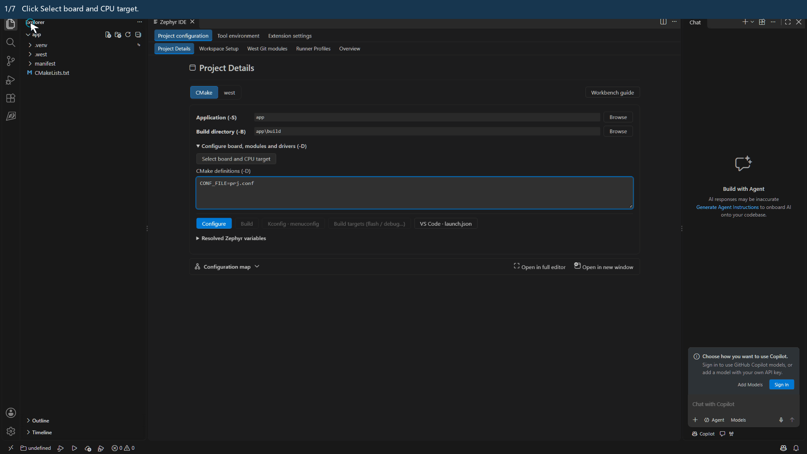
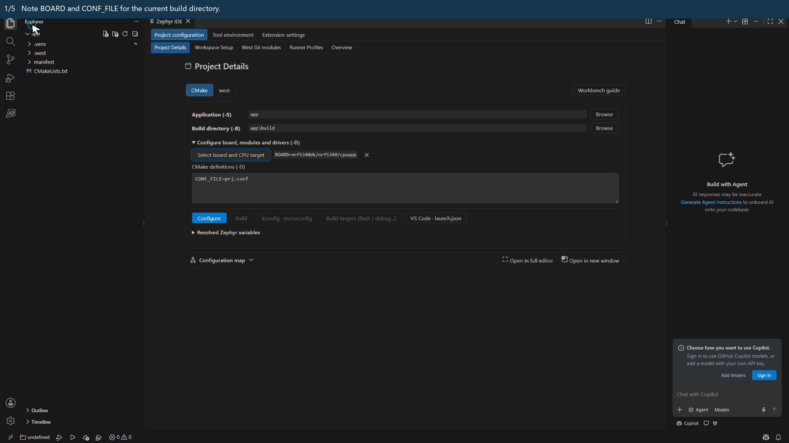
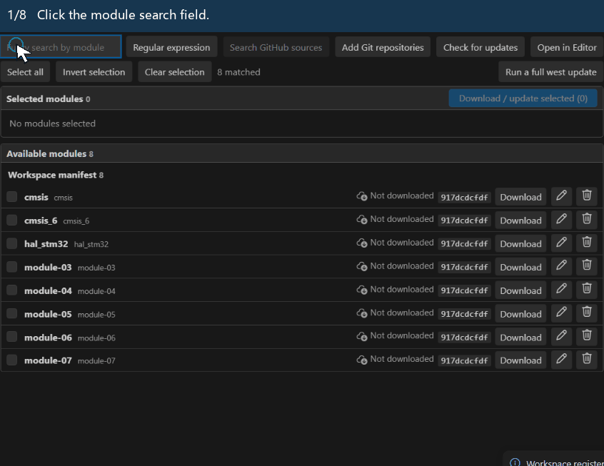

# Using the Zephyr IDE workbench

[简体中文](workbench.zh-cn.md)

Open Zephyr IDE from the Activity Bar. Choose the build method in Project configuration. The project, tool environment and extension settings share an editor. The task terminal shows the command and diagnostic output.

Sidebar shortcuts stay in the view headings. To show them only on hover throughout VS Code, turn off **Workbench › View: Always Show Header Actions** in your own settings.

## Select an application, board and CPU

1. For a west workspace, add an existing project or copy a Zephyr sample. Add a build configuration and choose a board, including the SoC, CPU cluster or variant supplied by the board. For a standalone application, choose **CMake → Application (-S) → Browse** and select the directory containing the application’s CMakeLists.txt. Zephyr’s `samples/hello_world` is a small first build.
2. Assign each board and CPU target its own build directory (-B). In CMake mode, open **Select board and CPU target** and search the local checkout. Your choice appears beside the selector, for example `BOARD=nrf5340dk/nrf5340/cpuapp`. Use × beside the choice to clear it. If your definitions also set `BOARD`, Configure uses your typed value and shows it beside the selector. For an out-of-tree board set `BOARD_ROOT` to the directory containing `boards`. You can also select an existing configured build directory.
3. Choose **Configure**, then **Build**. Inspect CMakeCache.txt for the effective board, toolchain and options. A typical debug image is `zephyr/zephyr.elf` inside the build directory.

In the walkthroughs, follow the pointer. An orange ring marks a click. Type part of a board or CPU name to filter. Enter chooses the first result. If discovery cannot locate the sources, use **Choose Zephyr source directory**.

**Try switching build methods.** In an empty folder the CMake page explains which file it needs. Choose an application containing `CMakeLists.txt`, select a board and enter `CONF_FILE`, switch to west, then return to CMake. The board should still appear beside the selector and the configuration file in your definitions. Each application and build directory has its own draft in this editor. Hover over a directory to see its full path. On Windows, forward slashes work in CMake definitions, including paths to your Python executable.

## Configure a device and its driver

Enable the actual board device node in a devicetree overlay and configure its pins or bus. Select the overlay with `DTC_OVERLAY_FILE`. Enable the driver subsystem in prj.conf, for example `CONFIG_I2C=y`. Use `CONF_FILE` for the main configuration and `EXTRA_CONF_FILE` for additional fragments. After configuring, open **Kconfig · menuconfig**, press `/` to search for a symbol and inspect its dependencies. Record desired settings in the application configuration and reconfigure to reproduce them in a clean build. Inspect `zephyr/.config` and `zephyr/zephyr.dts` for the effective software and hardware configuration.

## Use existing tools and offline components

In **Host tools**, read the available count beside the tool list. Each row shows the tool, its package ID and current status. Use the row action to install one missing tool or the group action to install all missing packages. Expand **Installation notes** for PATH and restart guidance.

Open **Tool environment → Host tools → Local tool environment**. Prepend executable directories to `PATH` using semicolons on Windows or colons on Linux. Set `ZEPHYR_BASE` to the Zephyr source directory and `ZEPHYR_SDK_INSTALL_DIR` to an unpacked SDK. The SDK page also accepts a local distribution bundle or an HTTPS archive URL. Check the target architecture’s compiler is present. For another toolchain, set `ZEPHYR_TOOLCHAIN_VARIANT` and any prefix required by that toolchain.

For Python wheels matching your OS and interpreter, set `PIP_FIND_LINKS` to the local directory and `PIP_NO_INDEX=1`. Use Git’s `url.<base>.insteadOf` to route a manifest URL to a local mirror. Set `GIT_ALLOW_PROTOCOL=file` to restrict Git to local file transport. To build from separately unpacked modules in CMake, supply `ZEPHYR_MODULES` as a semicolon-separated list of module directories. Supply the Python packages, compiler, sources and firmware files that the chosen application requires.

## Configure the west workspace

Set `update.fetch` to `smart` or `always` in the local west configuration, or select **Inherit west configuration** to clear the local override. The VS Code workspace stores `--narrow`, `--keep-descendants` and automatic dependency downloads. Expand **West Git modules** here to select and download projects. Reset, deactivate and unregister are under **Workspace Management**.

## Inspect dependencies and revisions

Open **west Git modules** to inspect the reason for a selection, the manifest revision and local checkout status. Search by part of a module name. Selected and available modules appear in separate lists. Download or update one row, or act on the selected group. Enter one repository address per line when adding repositories. Choose **Check for updates** for remote revision information. For moving references such as branches, matching the last known revision only describes the last check. The west manifest describes Git projects and a module’s `zephyr/module.yml` describes its binary blobs.

**Try the filter before downloading.** Enter `cms` and select `cmsis_6` if your manifest includes it. Change the filter to `hstm32`. The upper list still shows the selected revision. The row button acts on that module and the header button acts on the entire selection. Selecting a checkbox here queues the module for the group action.

Available modules are paged in groups of 20. Scroll within a page or use its header arrows. Search and bulk selection cover all matching projects. The selected list stays above the results and has its own download button.

Use **Project requirements → Import local blob** to select a declared firmware file and import a local copy. The workbench compares its SHA-256 before replacing the destination.

## Flash and debug

With west, select the build and runner. With CMake, choose a generated target such as `flash`, `debug` or `debugserver` if the build provides it. Some targets invoke a west runner internally. Vendor tools and debug adapters can also run independently. Choose **VS Code · launch.json** for a launch configuration targeting your ELF and probe. Actual target and probe support depends on the hardware, tools and Zephyr checkout.

[Applications and CMake](https://docs.zephyrproject.org/latest/develop/application/index.html) · [Modules and blobs](https://docs.zephyrproject.org/latest/develop/modules.html) · [SDK](https://docs.zephyrproject.org/latest/develop/toolchains/zephyr_sdk.html) · [Build, flash and debug](https://docs.zephyrproject.org/latest/develop/west/build-flash-debug.html)
