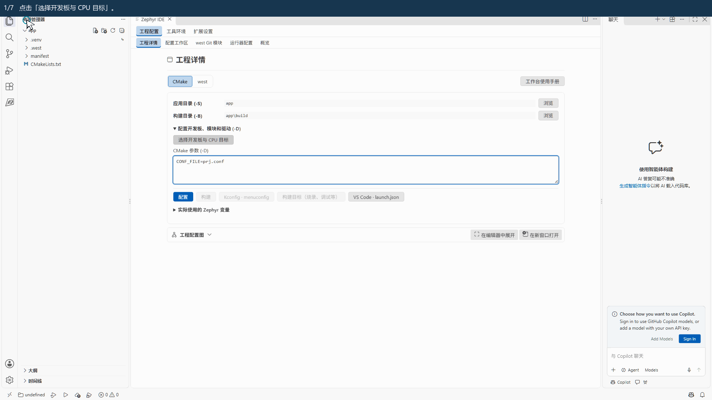
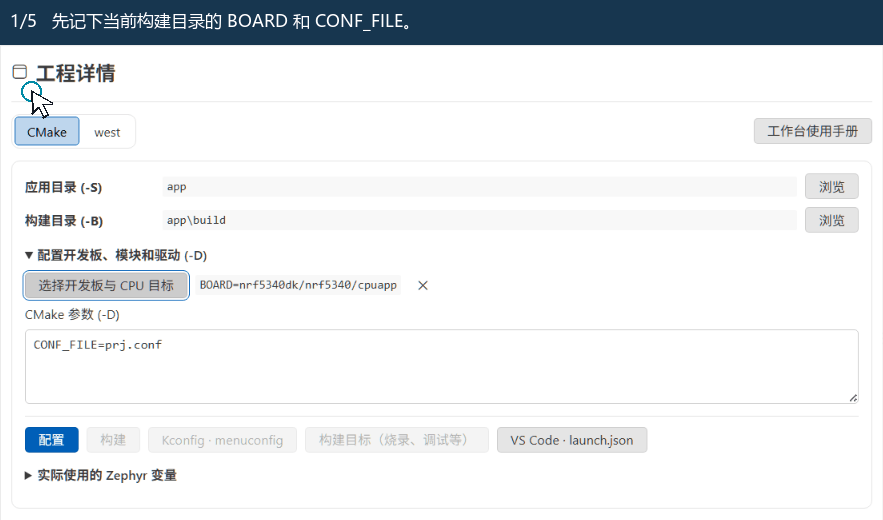
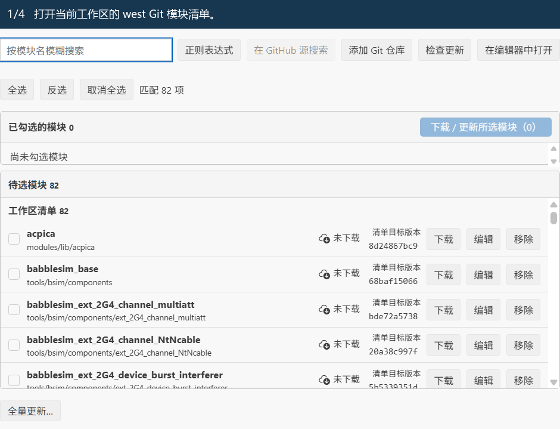

# Zephyr IDE 工作台使用手册

[English](workbench.md)

从活动栏进入 Zephyr IDE，在“工程配置”选择构建方式。工程、工具环境和扩展设置共用一个编辑区。任务命令和首条错误可在下方终端查看。

边栏各功能区的快捷操作常驻标题栏。如需在整个 VS Code 中恢复悬停显示，可在个人设置中关闭 `workbench.view.alwaysShowHeaderActions`。

## 选择应用、板和 CPU

1. 已有 west 工程时，选择或添加工程，再添加构建配置，选择开发板和板提供的 SoC、CPU 核或变体。需要示例时从 Zephyr samples 添加。已有独立应用时也可以选 **CMake → 应用 (-S) → 浏览**，选择包含应用 `CMakeLists.txt` 的目录，例如 Zephyr 的 `samples/hello_world`。
2. 为每个板和 CPU 分配自己的构建目录 (-B)。在 CMake 页点击“选择开发板与 CPU 目标”，搜索并选取当前源码支持的目标。所选值显示在选择按钮旁，例如 `BOARD=nrf5340dk/nrf5340/cpuapp`。点击旁边的 × 可清除选择。若手填参数也定义了 `BOARD`，配置时采用手填值，按钮旁会显示实际采用的值。自定义板可通过 `BOARD_ROOT` 指向包含 `boards` 目录的根。已配置过的目录可直接从“构建目录”打开。
3. 选择“配置”，再选择“构建”。查看生成的 `CMakeCache.txt` 核对板、工具链和构建选项。Zephyr 的 `build/zephyr/zephyr.elf` 是常见的调试映像路径，实际位置取决于所选构建目录和应用。

下方动图用箭头标出鼠标，橙色圆环表示点击。输入部分板名或 CPU 名即可筛选，按 Enter 采用第一项。未找到源码时，点击“选择 Zephyr 源码目录”。

**试一下构建方式切换。** 在空目录打开 CMake，页面会提示需要哪个文件。选择包含 `CMakeLists.txt` 的应用目录，选取开发板，再填写 `CONF_FILE`，切换到 west，再返回 CMake。板名应仍在选择按钮旁，手填的配置文件应仍在参数框中。当前编辑页按应用和构建目录保存草稿。将鼠标移到目录上可查看完整路径。Windows 下填写 CMake 路径时可使用正斜杠，包括 Python 解释器的路径。

## 配置驱动与 Kconfig

先在应用的 devicetree overlay 中启用板上真实存在的设备节点，配置引脚或总线。用 `DTC_OVERLAY_FILE` 指定 overlay。在 `prj.conf` 中启用相应驱动子系统，例如 `CONFIG_I2C=y`。用 `CONF_FILE` 选择主配置，用 `EXTRA_CONF_FILE` 追加配置片段。配置完成后打开 **Kconfig · menuconfig**，按 `/` 搜索符号、查看依赖。要让设置经得住清理构建，请将需要的值保存到应用配置文件，再重新配置。最终配置和设备树分别见构建目录的 `zephyr/.config`、`zephyr/zephyr.dts`。

## 本机环境与离线组件

打开“主机工具”，清单标题旁显示可用数量，每行列出工具名称、软件包标识和当前状态。可在行内安装一个缺失工具，也可批量安装缺失项。需要查看 PATH 与重启提示时，展开“安装说明”。

在“工具环境 → 主机工具 → 本机工具环境”设置单个变量。已有工具可将其可执行文件所在目录加入 `PATH`，Windows 使用分号，Linux 使用冒号。Zephyr 源码根对应 `ZEPHYR_BASE`，已解包 SDK 对应 `ZEPHYR_SDK_INSTALL_DIR`。也可以到 SDK 页面导入 SDK 发行包或输入 HTTPS 包地址。检查所需架构的编译器是否已安装。使用其他工具链时按其官方说明设置 `ZEPHYR_TOOLCHAIN_VARIANT` 以及所需前缀。

使用本地 Python wheel 时，这些 wheel 须适配操作系统和 Python 版本。将 `PIP_FIND_LINKS` 指向目录，`PIP_NO_INDEX` 设为 `1`。本地 Git 镜像可以通过 Git 的 `url.<base>.insteadOf` 映射现有清单地址。要限制 Git 仅使用本地文件，可设置 `GIT_ALLOW_PROTOCOL=file`。直接 CMake 使用散装模块时，将 `ZEPHYR_MODULES` 指向模块目录列表，用分号分隔。配置及构建仍需要该应用实际用到的 Python 包、工具链、模块和固件文件。

## 配置 west 工作区

`update.fetch` 使用 west 自身的本地配置。选择 `smart` 或 `always`，或选「继承 west 配置」清除本地覆盖。`--narrow`、`--keep-descendants` 和自动下载选项保存在当前 VS Code 工作区。从本页展开「west Git 模块」即可选择并下载；重置、停用和注销收在「管理工作区」中。

## 如何判断要下载什么

打开“west Git 模块”，查看当前配置识别出的依赖来源、清单目标版本和本地状态。模块名支持模糊搜索。已选项在上方，待选项在下方。可点击单行下载或更新，也可操作所有已选项。添加多个仓库时每行一个地址。需要查询远端变化时点击“检查更新”。使用分支或标签时，本地检出与上次已知版本一致，并不能证明远端引用今天没有变化。Git 源码仓库与二进制 blob 分别由 west 清单和模块的 `zephyr/module.yml` 声明。

**下载前可以先试筛选。** 输入 `cms`，如果清单包含 `cmsis_6`，就勾选它。把搜索词改成 `hstm32`，上方仍会显示刚勾选的模块及其目标版本。勾选用于准备批量操作。行内按钮只处理该模块，已选区标题上的按钮处理整个已选清单。

待选项每页最多 20 个，可滚轮浏览或用标题栏箭头翻页。搜索和全选作用于全部匹配项，已选项始终在上方。下载按钮明确区分当前行和整个已选组。

在“工程所需组件 → 导入本地二进制组件”选择模块声明的固件和本地文件。工作台先核对 SHA-256，再替换目标文件。

## 烧录和调试

west 模式使用所选构建与 runner。直接 CMake 模式选择当前构建实际提供的目标，例如 `flash`、`debug` 或 `debugserver`。有些目标内部调用 west runner，另一些环境可使用供应商工具和调试适配器。使用自己的调试配置时，从 **VS Code · launch.json** 选择与当前 ELF 和探针对应的配置。目标、适配器和探针的支持由所用 Zephyr 版本及硬件决定。

[Zephyr 应用与 CMake](https://docs.zephyrproject.org/latest/develop/application/index.html) · [模块和 blob](https://docs.zephyrproject.org/latest/develop/modules.html) · [SDK](https://docs.zephyrproject.org/latest/develop/toolchains/zephyr_sdk.html) · [构建、烧录和调试](https://docs.zephyrproject.org/latest/develop/west/build-flash-debug.html)
